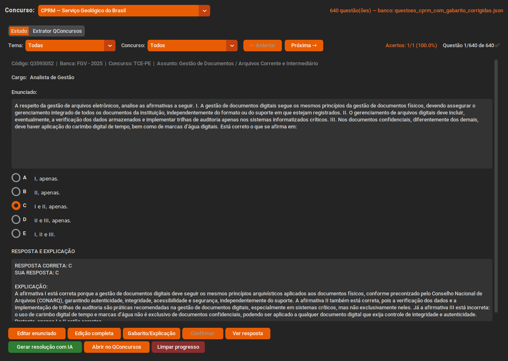
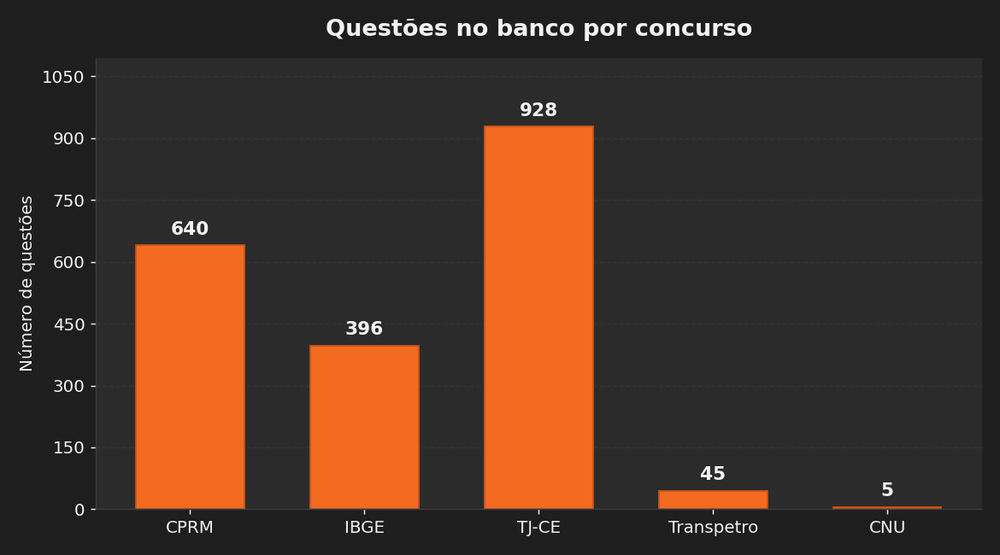
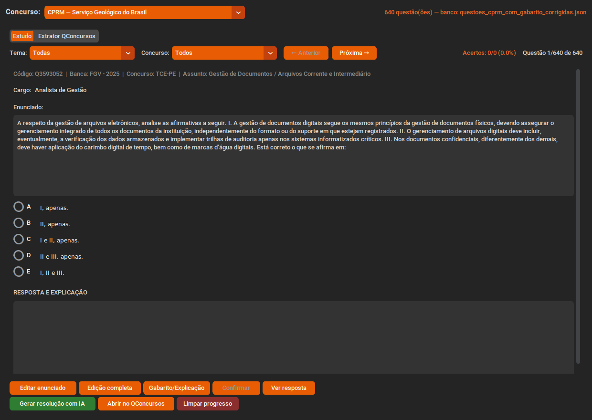
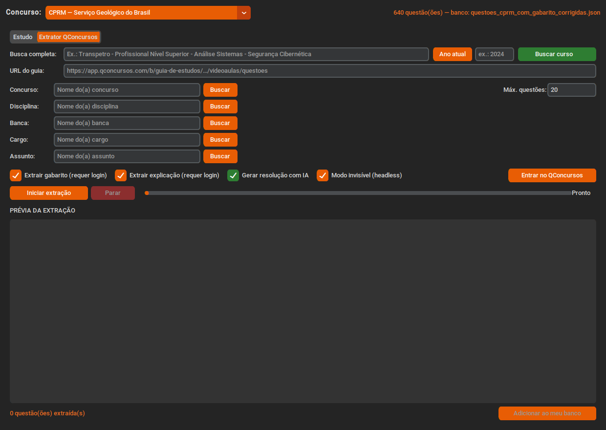
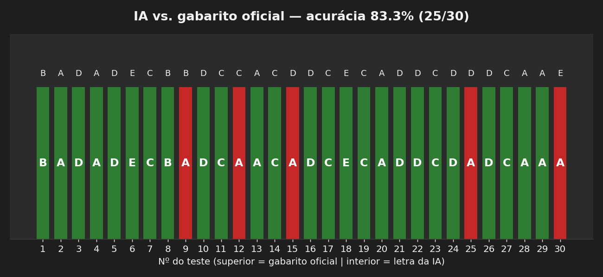
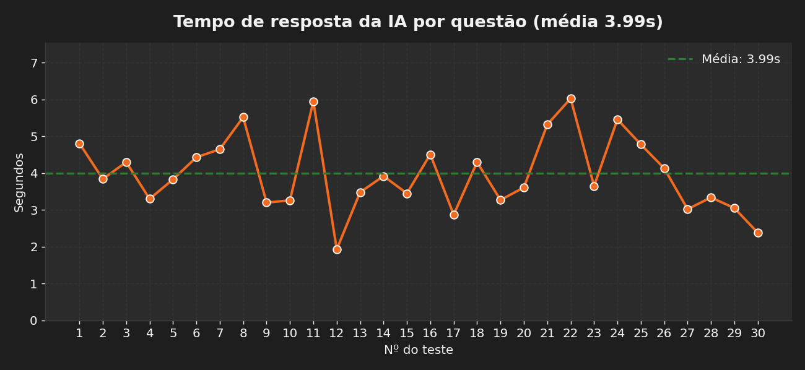
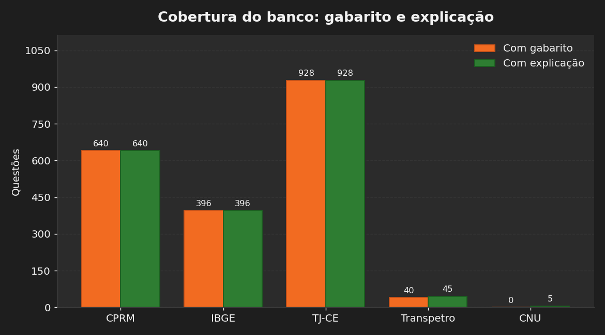

# Study Concursos

Aplicação de estudo para concursos públicos, com interface moderna (customtkinter), extração automática de questões do [QConcursos](https://www.qconcursos.com) e resoluções geradas por IA (Ollama Cloud). Suporta vários concursos ao mesmo tempo, cada um com seu banco de questões e seu progresso independentes.

<p align="center">
  
</p>

## Índice

- [Concursos suportados](#concursos-suportados)
- [Funcionalidades](#funcionalidades)
- [Resultados dos testes](#resultados-dos-testes)
- [Requisitos e instalação](#requisitos-e-instalação)
- [Uso](#uso)
- [Resoluções com IA](#resoluções-com-ia)
- [Estrutura de dados](#estrutura-de-dados)
- [Notas](#notas)

## Concursos suportados

| Concurso | Banco de questões | Progresso |
|----------|-------------------|-----------|
| CPRM — Serviço Geológico do Brasil | `questoes_cprm_com_gabarito_corrigidas.json` (640) | `study_progress_cprm.db` |
| IBGE — Instituto Brasileiro de Geografia e Estatística | `questoes_ibge_com_gabarito.json` (396) | `study_progress_ibge.db` |
| TJ-CE — Tribunal de Justiça do Ceará | `questoes_tj_ce_com_gabarito.json` (928) | `study_progress_tj-ce.db` |
| Transpetro — Petróleo e Gás | `questoes_transpetro.json` (45) | `study_progress_transpetro.db` |
| CNU — Concurso Nacional Unificado | `questoes_cnu.json` (5) | `study_progress_cnu.db` |

Novos concursos são detectados automaticamente: basta colocar um JSON novo em `questões/` e o seletor passa a oferecê-lo.

<p align="center">
  
</p>

## Funcionalidades

### Seletor de concurso

Escolha o concurso na barra superior; o app carrega o banco de questões e o progresso daquele concurso. A troca pode ser feita a qualquer momento sem perder o progresso de nenhum deles.

### Aba Estudo

<p align="center">
  
</p>

- Filtros por tema e por concurso, com navegação entre questões
- Seleção de alternativa, confirmação e verificação contra o gabarito
- Exibição do gabarito comentado (explicação) de cada questão
- Placar de acertos com porcentagem, e limpeza do progresso
- **Gerar resolução com IA** para a questão atual, com um clique
- **Modos de edição avançada**: enunciado/cargo, edição completa (metadados e alternativas) e gabarito/explicação
- Abertura direta da questão no QConcursos

### Aba Extrator QConcursos

<p align="center">
  
</p>

- **Busca completa**: você digita o nome do concurso (ex.: `Transpetro - Profissional Nível Superior - Análise Sistemas`) e o botão resolve o guia de estudos, as disciplinas e os assuntos sozinho
- Filtros manuais opcionais: concurso, disciplina, banca, cargo, assunto e ano
- Extração de enunciado, alternativas, gabarito e explicação
- **Geração de resoluções com IA em lote** durante a extração
- Extração em segundo plano, com log, barra de progresso, prévia e botão de parar
- Importação para o banco de estudo sem duplicar questões já existentes
- Modo invisível (headless) para extração sem abrir a janela do Chrome

## Resultados dos testes

### Acurácia da IA no gabarito

Teste executado em **30 questões reais** sorteadas do banco (semente fixa), comparando a letra sugerida pela IA com o gabarito oficial de cada prova:

| Métrica | Resultado |
|---------|-----------|
| Questões testadas | 30 |
| Acertos | 25 |
| **Acurácia** | **83,3 %** |
| Tempo médio por resolução | 3,99 s |
| Tempo mínimo / máximo | 1,93 s / 6,03 s |
| Resoluções geradas | 30/30 (100 %) |

<p align="center">
  
</p>

- **Verde** = a IA coincidiu com o gabarito oficial
- **Vermelho** = a IA divergiu
- Letra superior = gabarito oficial · Letra interior = resposta da IA

<p align="center">
  
</p>

Observação: a acurácia varia conforme o modelo escolhido em `OLLAMA_MODEL`. No plano gratuito do Ollama Cloud o padrão é `gpt-oss:120b`; testes com `gpt-oss:20b` e `gemma4:31b` tiveram desempenho inferior nos mesmos casos.

### Cobertura do banco

Todas as questões dos concursos principais já estão com gabarito e explicação preenchidos, prontas para estudo imediato:

<p align="center">
  
</p>

## Requisitos e instalação

- Python 3.10 ou superior
- Google Chrome (ou Chromium) instalado
- Linux, Windows ou macOS
- Conta no [Ollama Cloud](https://ollama.com) (para as resoluções com IA)

```bash
git clone <repositorio>
cd Study_Concursos

python3 -m venv .venv
source .venv/bin/activate        # Windows: .venv\Scripts\activate

pip install -r requirements.txt
```

O chromedriver é baixado automaticamente na primeira execução da extração, na versão compatível com o Chrome instalado.

### Configuração da IA

Copie o `.env.example` para `.env` na raiz do projeto e preencha com suas chaves (o `.env` é ignorado pelo Git):

```bash
OLLAMA_BASE_URL=https://ollama.com
OLLAMA_MODEL=gpt-oss:120b
OLLAMA_API_KEY=sua_chave,sua_chave2,sua_chave3
```

- `OLLAMA_API_KEY` aceita **várias chaves separadas por vírgula**; quando uma atinge o limite do plano gratuito, a próxima é usada automaticamente
- Modelos do plano gratuito: `gpt-oss:120b`, `gpt-oss:20b`, `nemotron-3-nano:30b`, `gemma4:31b`

## Uso

### Interface gráfica

```bash
python app.py
```

1. Escolha o concurso na barra superior
2. Na aba **Estudo**, filtre por tema e responda as questões — ou clique em *Gerar resolução com IA*
3. Na aba **Extrator QConcursos**, busque o curso e importe questões novas para o concurso selecionado

### Linha de comando

```bash
# Procurar um concurso pelo nome
python qconcursos.py buscar "CPRM"

# Extrair 30 questões de FGV/Direito Administrativo, com gabarito e explicação
python qconcursos.py extrair "TCE-PE" --disciplina "Direito Administrativo" --banca FGV --maximo 30

# Extrair sem coletar gabarito (não exige login)
python qconcursos.py extrair "CPRM" --maximo 10 --sem-gabarito

# Listar sem salvar no banco
python qconcursos.py extrair "Receita Federal" --maximo 5 --apenas-listar
```

Opções úteis de `extrair`: `--ano`, `--cargo`, `--assunto`, `--oculto` (Chrome em segundo plano), `--sem-explicacao`, `--apenas-listar` e `--url` (URL do QConcursos já filtrada).

## Resoluções com IA

A IA recebe o enunciado, as alternativas e o gabarito oficial (quando existe) e devolve:

1. Uma linha `Resposta: X` com a letra sugerida
2. A explicação do raciocínio, com os conceitos e o fundamento legal

Regras de gravação importantes:

- A IA grava em `explicacao` — a explicação oficial existente **nunca é sobrescrita**
- O gabarito só é preenchido pela IA **quando a questão não tem gabarito**
- Tudo é salvo no JSON do concurso, junto com as estatísticas de progresso no SQLite

## Estrutura de dados

- `questões/` — um JSON de questões por concurso
- `backup/` — um SQLite de progresso por concurso, mais cópias de segurança automáticas do JSON antes de cada gravação
- `perfil_navegador/` — perfil do Chrome usado pelo extrator (login persistente; ignorado pelo Git)
- `.env` — chaves e configuração da IA (ignorado pelo Git)
- `docs/imagens/` — capturas de tela e gráficos de teste

## Notas

- O QConcursos limita a 10 questões/dia para contas gratuitas; o extrator avisa quando o limite é atingido e para de coletar gabaritos
- Ao importar questões que já existem no banco, apenas os campos vazios (gabarito/explicação) são preenchidos — nada é sobrescrito
- Se a extração travar no desafio de segurança do site, apague a pasta `perfil_navegador/`; ela é recriada limpa automaticamente
- O plano gratuito do Ollama Cloud tem cota diária; se ela esgotar, as chaves restantes do `.env` são usadas automaticamente
